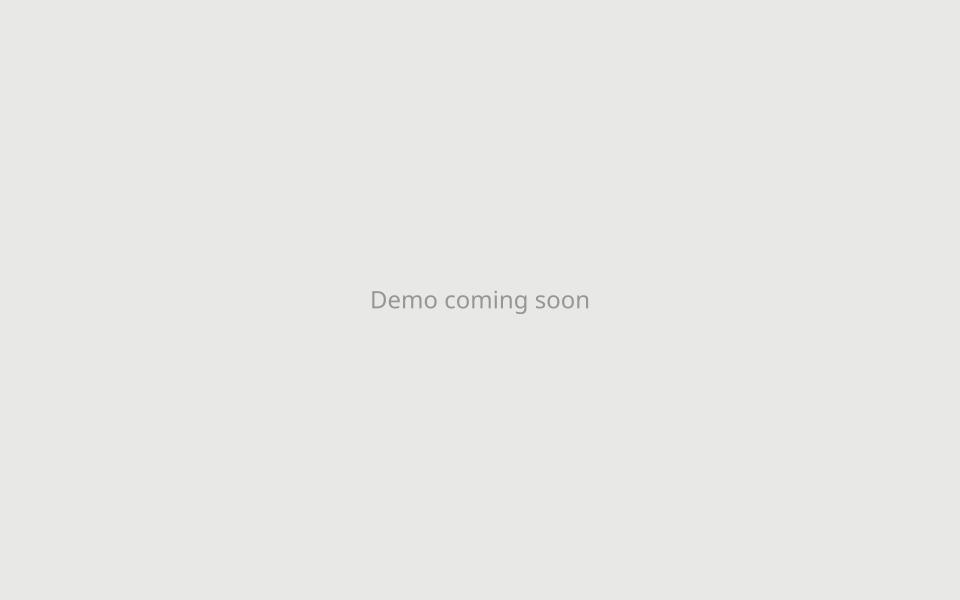

# Agent Window

UNIX哲学のmacOS向けAgent application。

https://okadaharuto.com/agent-window/

  
  

対応CLI: Claude・Codex・Antigravity・Cursor・Grok

---

## Agent Windowの原則

1. Timelineが単位で、実体はJSONLのログ
2. Agent Processは普通のCLI
3. Agent・WorkspaceはTimelineの途中で差し替えられる

## Agent Windowについてもっと知る

Fit Window

https://github.com/user-attachments/assets/d9f3cbc2-39c5-4b28-8be9-0d98c8328e1f

アプリケーションは必要な面積だけを使います。

- `⌥⌘H`で`Fit Window`を有効にすると、Windowが最新のメッセージに合わせて自動でResizeされます。
- `⌥⌘[` `⌥⌘]`で表示するメッセージ数を調整できます。
- `⌥⌘M`でWindowは最小化され、次の新規メッセージまで待機します。

Prompt Box

https://github.com/user-attachments/assets/5ce44e5a-de19-46cb-9861-11caac880c08

入力欄は必要なときだけ現れ、Timelineの場所を取りません。入力されたテキストは、Agent CLIのPaneにそのまま入力されます。`⌃1`–`⌃9`で送信先を切り替えます。

Commands

AWが配線するコマンドは固有のものだけです。CLIのコマンドはPane本体から実行します。

Substance is CLI

https://github.com/user-attachments/assets/006bfe63-5e14-4abe-9039-e7e86b1a5851

`/openpane`・`timeline menu → tmux pane`・Running表示のタップからCLI本体を確認できます。

Timeline States Actions

TimelineはRename・Archive・Reviveできます。Archiveしてもログは残り、Reviveすると保存したWorkspaceとAgent構成で再開します。Archive中はWorkspaceの変更・Agent構成のリセット・Timelineの削除もできます。

Independent Sidebar

`Fit Window`中は、Sidebarは独立Windowになります。好きな位置、大きさで保持できます。

Window Resize / Move

https://github.com/user-attachments/assets/7d155603-6263-4f5e-971d-df41952b0b29

ResizeはWindow全体の相似関係を保ちます。作業の邪魔にならない位置と大きさに素早く調整できます。

Agent to Agent

`tmux/agent_send/SKILL.md`を利用すれば、A2A通信ができます。プロトコルはなく、宛先のPaneに`[From: Claude]`のようなprefix付きで`tmux send-keys`が実行されます。使う場合は、`tmux/agent_send/agent-send`へのPATHを配線します。

File Attachment

`+` / drag & drop / pasteでファイルを添付できます。添付したファイルは`<workspace>/.agent-window/uploads/`に保存され、そのpathがplain textとして送信テキストの末尾に追加されます。

File Search

入力欄での`@`から、Workspace内のファイルを検索できます。対象はGit管理下に限定しています。子Repoを監視対象に追加すると、その分のファイルも対象になります。

Add Repository

指定した子ディレクトリをRepo rootとして、監視対象に追加・削除できます。追加したRepoの一覧は`timeline menu → Repository`に表示され、Sidebarの表示を切り替えられます。Worktreeの一覧は、選択中のRepoのものになります。

Worktrees

`timeline menu → Worktree`からSidebarに表示するlinked worktreeを切り替えることができます。

Sidebar

https://github.com/user-attachments/assets/d878b522-99fb-4ba6-9326-29d73bace9ea

Sidebarには`FSEvents`によるイベント駆動でGit・Workspaceの状態が表示されます。横幅調整に加え、上下（`⇧⌥⌘E`）・左右（`⇧⌘E`）を入れ替えることができます。

File Open

Desktopには独自のFile Viewerはありません。原則として既定のアプリで展開されます。DiffはGitに設定されたdiff toolをそのまま利用します。素早い確認には`⌥ + click` / `⌘Y`でmacOSのQuick Lookを利用します。

Timeline Search

`⌘F`でTimelineを全文検索します。`⇧`併用で、10件単位で移動できます。

Export

Timelineのログを範囲指定して、JSONLまたはHTMLとしてExportできます。HTMLは表示されたWebViewをそのまま焼き込むため、見た目は完全に保持されます。

Follow Changes

Follow Changesを有効にすると、Sidebarの表示が最後に更新されたRepo・Worktreeに自動追従します。表示対象を明示指定すると解除されます。

Open in browser

Agent Windowの基本操作はブラウザのみで完結します（`⇧⌥⌘O`）。特定のTimelineだけを直接ブラウザで開くことも可能です（`⌥⌘O`）。

HUD

エラー表示から通常操作のフィードバックに至るまで、一時的な通知はTimeline上部のHUDに集約され、滑らかに切り替わります。一部のHUDは常駐します。

What AW records

Agentのメッセージには、投影元のnative logのpath・offsetが記録されます。ユーザーのメッセージには送信元のクライアント（mobile / desktop）が記録されます。

メッセージ上を右クリックすることで粒度別のCopyが可能です（モバイルではCopyボタンを長押しします）。ログ全体の正本（JSONL）は`⌥⌘L`で開くことができます。

Pin Changes

現在の差分をSidebarを開くことなく、Timeline上部に小さく保持できます。hoverで一覧が展開されます。

## iPhoneから操作する

TailscaleでHubに接続し、PWAとして使用します

  
  

More screenshots

  
  
  
  
  
  
  
  

## Footprint

- **Source**:
  - **Size**: 1.6 MB・40,000 LOC
  - **Stack**: HTML・CSS・vanilla JavaScript・Python stdlib
- **App**:
  - **Spec**: native launcher of local repo
  - **Requirements**: python3・tmux・Xcode CLI
  - **Build**: 1s from `./macos/build`
  - **Size** : < 200 KB
- **System**:
  - **Network**: CDN（`marked`・`DOMPurify`・`katex`・`highlight.js`）
  - **Port**: value of `server/port` (default `8788`)
  - **Files**: `~/.agent-window/`(log)・`{workspace}/.agent-window/`(symlink・uploaded file)
